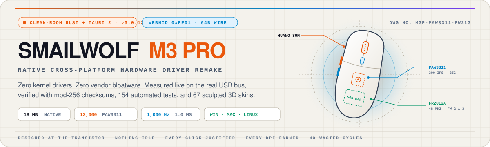
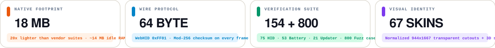
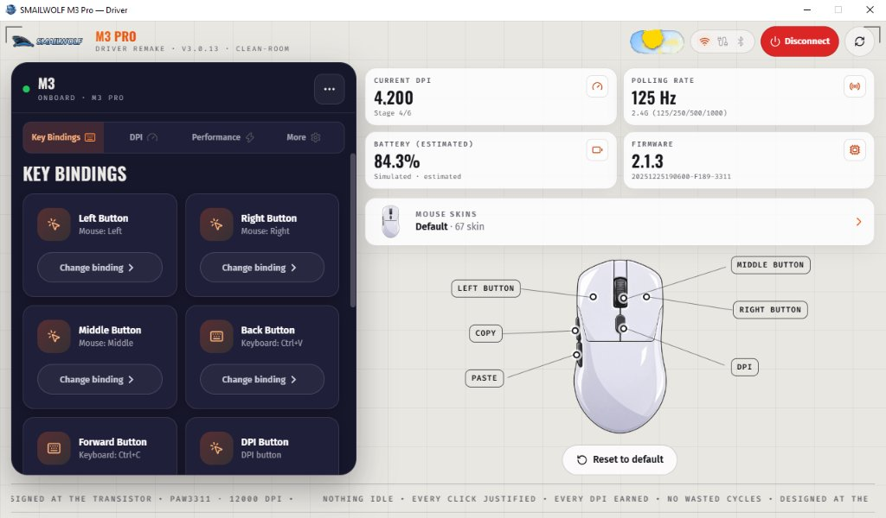
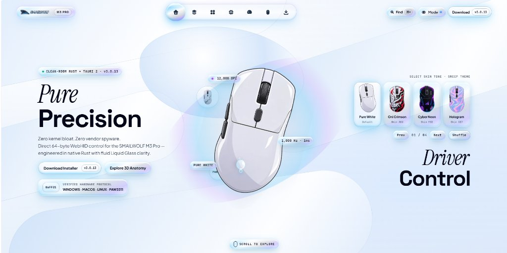
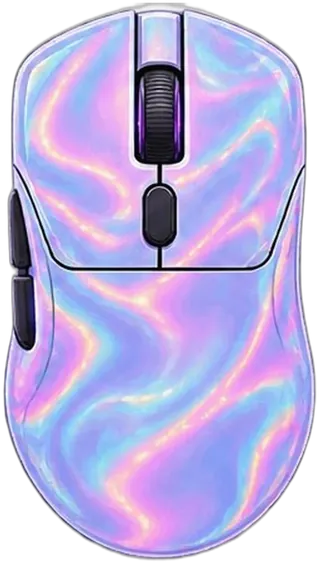
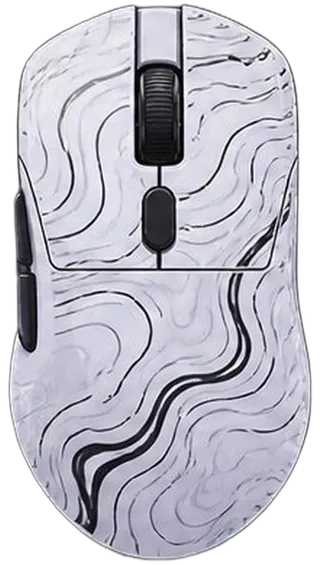
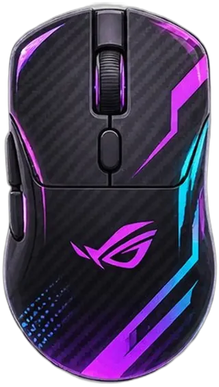
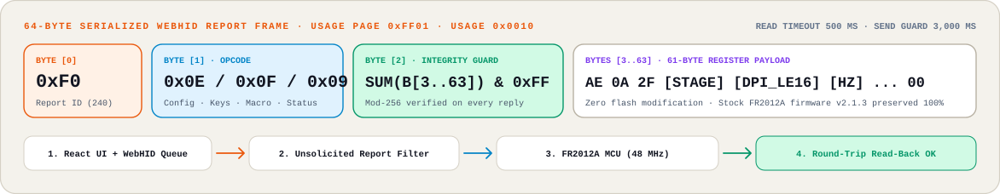
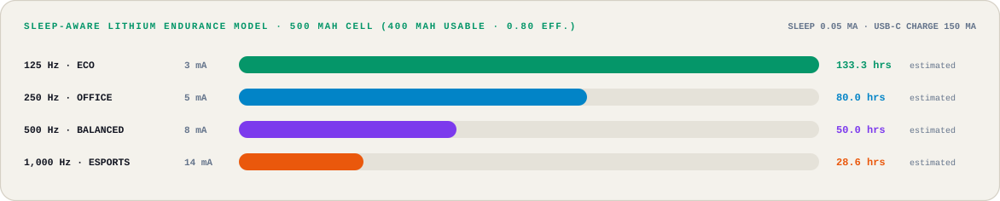

<div align="center">

<picture>
  <source media="(prefers-color-scheme: dark)" srcset="docs/svg/hero-dark.svg" />
  <source media="(prefers-color-scheme: light)" srcset="docs/svg/hero-light.svg" />
  
</picture>

<br />
<br />

<a href="#-download--all-platforms">
  
</a>
&nbsp;
<a href="#-live-visual-proof">
  
</a>
&nbsp;
<a href="#-clean-room-webhid-protocol">
  
</a>
&nbsp;
<a href="https://discord.gg/H6WkXburX">
  
</a>

<br />
<br />

<picture>
  <source media="(prefers-color-scheme: dark)" srcset="docs/svg/telemetry-strip-dark.svg" />
  <source media="(prefers-color-scheme: light)" srcset="docs/svg/telemetry-strip-light.svg" />
  
</picture>

</div>

---

<a id="-live-visual-proof"></a>
##  &nbsp;Live Visual Proof — Real Driver &amp; Liquid Glass Web Stage

Built from scratch on the live USB bus for the **SMAILWOLF M3 Pro** (`PixArt PAW3311` · `FR2012A 48 MHz MCU` · `Stock Firmware v2.1.3`). Zero kernel drivers. Zero background bloatware. Zero vendor telemetry.

<table>
  <tr>
    <td width="50%" valign="top">
      <a href="docs/media/driver-app-real.jpg">
        
      </a>
      <br />
      <sub><strong>DESKTOP DRIVER · v3.0.13-rust (Tauri 2 + Rust)</strong> — Live 16:9 architectural blueprint UI showing <code>4,200 DPI</code>, <code>125–1,000 Hz</code> tri-mode cluster, <code>84.3%</code> sleep-aware battery estimator, <code>FW 2.1.3</code> read-back, and direct button pin remapping.</sub>
    </td>
    <td width="50%" valign="top">
      <a href="docs/media/landing-page-real.jpg">
        
      </a>
      <br />
      <sub><strong>INTERACTIVE LANDING STAGE · <code>landing/</code></strong> — Pure Crystal Liquid Glass showcase featuring 360° draggable Hero rig, 121-frame 3D hardware dissection with PAW3311 X-Ray lens, 67-skin Coverflow, Live 1,000 Hz + Huano 80M switch bench, and 3 adaptive GPU modes.</sub>
    </td>
  </tr>
</table>

---

<a id="-download--all-platforms"></a>
##  &nbsp;Download &mdash; All Desktop Platforms (`v3.0.13-rust`)

Every installer below is built cleanly from source in CI and published on [**GitHub Releases (`v3.0.13-rust`)**](https://github.com/duyzoz/Smail-Wolf-M3-Pro/releases/tag/v3.0.13-rust). Master integrity hashes are published in [`SHA256SUMS.txt`](https://github.com/duyzoz/Smail-Wolf-M3-Pro/releases/download/v3.0.13-rust/SHA256SUMS.txt).

<table>
  <thead>
    <tr>
      <th align="left">Platform</th>
      <th align="left">Architecture</th>
      <th align="left">Installer / Package Formats</th>
      <th align="left">Notes</th>
    </tr>
  </thead>
  <tbody>
    <tr>
      <td> &nbsp;<strong>Windows</strong></td>
      <td><code>x64 (64-bit)</code></td>
      <td>
        <a href="https://github.com/duyzoz/Smail-Wolf-M3-Pro/releases/download/v3.0.13-rust/SMAILWOLF-M3-Pro-Driver_3.0.13_x64-setup.exe"><code>.exe</code> (NSIS)</a> &middot;
        <a href="https://github.com/duyzoz/Smail-Wolf-M3-Pro/releases/download/v3.0.13-rust/SMAILWOLF-M3-Pro-Driver_3.0.13_x64.msi"><code>.msi</code></a> &middot;
        <a href="https://github.com/duyzoz/Smail-Wolf-M3-Pro/releases/download/v3.0.13-rust/SMAILWOLF-M3-Pro-Driver_3.0.13_x64.zip"><code>.zip</code> (Portable)</a>
      </td>
      <td>Recommended · WebView2 built into Windows 11</td>
    </tr>
    <tr>
      <td> &nbsp;<strong>Windows</strong></td>
      <td><code>x32 (x86)</code></td>
      <td>
        <a href="https://github.com/duyzoz/Smail-Wolf-M3-Pro/releases/download/v3.0.13-rust/SMAILWOLF-M3-Pro-Driver_3.0.13_x86-setup.exe"><code>.exe</code> (NSIS)</a> &middot;
        <a href="https://github.com/duyzoz/Smail-Wolf-M3-Pro/releases/download/v3.0.13-rust/SMAILWOLF-M3-Pro-Driver_3.0.13_x86.msi"><code>.msi</code></a> &middot;
        <a href="https://github.com/duyzoz/Smail-Wolf-M3-Pro/releases/download/v3.0.13-rust/SMAILWOLF-M3-Pro-Driver_3.0.13_x86.zip"><code>.zip</code> (Portable)</a>
      </td>
      <td>Legacy 32-bit Windows 10 systems</td>
    </tr>
    <tr>
      <td> &nbsp;<strong>macOS</strong></td>
      <td><code>arm64 (Apple Silicon)</code></td>
      <td>
        <a href="https://github.com/duyzoz/Smail-Wolf-M3-Pro/releases/download/v3.0.13-rust/SMAILWOLF-M3-Pro-Driver_3.0.13-macos-arm64.dmg"><code>.dmg</code></a> &middot;
        <a href="https://github.com/duyzoz/Smail-Wolf-M3-Pro/releases/download/v3.0.13-rust/SMAILWOLF-M3-Pro-Driver_3.0.13-macos-arm64.app.zip"><code>.app.zip</code></a> &middot;
        <a href="https://github.com/duyzoz/Smail-Wolf-M3-Pro/releases/download/v3.0.13-rust/SMAILWOLF-M3-Pro-Driver_3.0.13-macos-arm64.app.tar.gz"><code>.app.tar.gz</code></a>
      </td>
      <td>Apple M1 / M2 / M3 / M4 native binary</td>
    </tr>
    <tr>
      <td> &nbsp;<strong>macOS</strong></td>
      <td><code>x64 (Intel)</code></td>
      <td>
        <a href="https://github.com/duyzoz/Smail-Wolf-M3-Pro/releases/download/v3.0.13-rust/SMAILWOLF-M3-Pro-Driver_3.0.13-macos-x64.dmg"><code>.dmg</code></a> &middot;
        <a href="https://github.com/duyzoz/Smail-Wolf-M3-Pro/releases/download/v3.0.13-rust/SMAILWOLF-M3-Pro-Driver_3.0.13-macos-x64.app.zip"><code>.app.zip</code></a> &middot;
        <a href="https://github.com/duyzoz/Smail-Wolf-M3-Pro/releases/download/v3.0.13-rust/SMAILWOLF-M3-Pro-Driver_3.0.13-macos-x64.app.tar.gz"><code>.app.tar.gz</code></a>
      </td>
      <td>Intel Mac native binary</td>
    </tr>
    <tr>
      <td> &nbsp;<strong>Linux</strong></td>
      <td><code>x64 (x86_64)</code></td>
      <td>
        <a href="https://github.com/duyzoz/Smail-Wolf-M3-Pro/releases/download/v3.0.13-rust/SMAILWOLF-M3-Pro-Driver_3.0.13-linux-x64.AppImage"><code>.AppImage</code></a> &middot;
        <a href="https://github.com/duyzoz/Smail-Wolf-M3-Pro/releases/download/v3.0.13-rust/SMAILWOLF-M3-Pro-Driver_3.0.13-linux-x64.deb"><code>.deb</code></a> &middot;
        <a href="https://github.com/duyzoz/Smail-Wolf-M3-Pro/releases/download/v3.0.13-rust/SMAILWOLF-M3-Pro-Driver_3.0.13-linux-x64.rpm"><code>.rpm</code></a> &middot;
        <a href="https://github.com/duyzoz/Smail-Wolf-M3-Pro/releases/download/v3.0.13-rust/SMAILWOLF-M3-Pro-Driver_3.0.13-linux-x64.tar.gz"><code>.tar.gz</code></a>
      </td>
      <td>Debian, Ubuntu, Fedora, Arch &amp; portable tarball</td>
    </tr>
    <tr>
      <td> &nbsp;<strong>Linux</strong></td>
      <td><code>arm64 (aarch64)</code></td>
      <td>
        <a href="https://github.com/duyzoz/Smail-Wolf-M3-Pro/releases/download/v3.0.13-rust/SMAILWOLF-M3-Pro-Driver_3.0.13-linux-arm64.AppImage"><code>.AppImage</code></a> &middot;
        <a href="https://github.com/duyzoz/Smail-Wolf-M3-Pro/releases/download/v3.0.13-rust/SMAILWOLF-M3-Pro-Driver_3.0.13-linux-arm64.deb"><code>.deb</code></a> &middot;
        <a href="https://github.com/duyzoz/Smail-Wolf-M3-Pro/releases/download/v3.0.13-rust/SMAILWOLF-M3-Pro-Driver_3.0.13-linux-arm64.rpm"><code>.rpm</code></a> &middot;
        <a href="https://github.com/duyzoz/Smail-Wolf-M3-Pro/releases/download/v3.0.13-rust/SMAILWOLF-M3-Pro-Driver_3.0.13-linux-arm64.tar.gz"><code>.tar.gz</code></a>
      </td>
      <td>ARM64 Linux workstations &amp; SBCs</td>
    </tr>
  </tbody>
</table>

> **Unsigned Open-Source Verification:** Binaries are MIT-licensed and not commercially EV-signed. Verify [`SHA256SUMS.txt`](https://github.com/duyzoz/Smail-Wolf-M3-Pro/releases/download/v3.0.13-rust/SHA256SUMS.txt) before launching:
> - **Windows:** `CertUtil -hashfile SMAILWOLF-M3-Pro-Driver_3.0.13_x64-setup.exe SHA256` &rarr; if SmartScreen prompts, choose *More info &rarr; Run anyway*.
> - **macOS / Linux:** `shasum -a 256 SMAILWOLF-M3-Pro-Driver_3.0.13*` (on macOS, right-click &rarr; *Open* or `xattr -cr "SMAILWOLF M3 Pro Driver.app"`).
> - **Hardware Note:** Direct WebHID (`0xFF01`) works out-of-the-box on Windows WebView2 (Chromium-based). On macOS/Linux WebKit webviews, Demo Mode &amp; full UI run natively while live USB HID pairing uses Chromium/Chrome WebHID (`npm run dev`).

---

##  &nbsp;67 Precision-Aligned Real Mouse Cutouts

Every skin is cleanly segmented onto a standardized **`944 × 1667`** transparent WebP canvas so all 6 interactive button callout anchors align pixel-for-pixel inside the desktop driver without ever touching mouse firmware.

<table>
  <tr>
    <td align="center" width="16.6%"><br /><sub><strong>Pure White</strong><br /><code>DEFAULT</code></sub></td>
    <td align="center" width="16.6%"><br /><sub><strong>Oni Crimson</strong><br /><code>SKIN A03</code></sub></td>
    <td align="center" width="16.6%"><br /><sub><strong>Cyber Neon</strong><br /><code>SKIN F02</code></sub></td>
    <td align="center" width="16.6%"><br /><sub><strong>Hologram</strong><br /><code>SKIN C07</code></sub></td>
    <td align="center" width="16.6%"><br /><sub><strong>Stealth</strong><br /><code>SKIN B01</code></sub></td>
    <td align="center" width="16.6%"><br /><sub><strong>Prism Wave</strong><br /><code>SKIN C05</code></sub></td>
  </tr>
</table>

---

<a id="-clean-room-webhid-protocol"></a>
##  &nbsp;Clean-Room WebHID Wire Protocol

Every packet below was captured directly off the real USB bus, validated across round-trip hardware read-backs, and hardened with unsolicited-report filtering (`250` DPI push, `237` wireless status, `48` battery) so physical button presses never desynchronize active writes.

<div align="center">
<picture>
  <source media="(prefers-color-scheme: dark)" srcset="docs/svg/wire-protocol-dark.svg" />
  <source media="(prefers-color-scheme: light)" srcset="docs/svg/wire-protocol-light.svg" />
  
</picture>
</div>

| Operation | 64-Byte Command Prefix | Verification Status |
|---|---|---|
| Read Firmware / Info / Config | `[240, 4]` &middot; `[240, 82]` &middot; `[240, 14, ...]` | Proven live &middot; Mod-256 checksum 9/9 matched |
| Read Keymap / Status / Battery | `[240, 8, ...]` &middot; `[240, 237]` &middot; `[240, 48, ...]` | Proven live via serialized queue + unsolicited filter |
| Write DPI / Polling / Sleep Config | `[240, 15, 174, 10, 47, ...]` | **Proven live &middot; 100% round-trip matched (3 runs)** |
| Write 6-Button Keymap | `[240, 9, 165, 34, 44, ...]` | Same verified write path (DPI button hardware-locked) |
| Write Millisecond Delta Macro | `[240, 13, ...]` + Commit `[240, 16, 165, 34, 0, 0, 0, 5]` | `performance.now()` deltas &middot; write-only on MCU |

---

##  &nbsp;Sleep-Aware Lithium Battery Telemetry

Stock M3 Pro firmware lacks a dedicated Coulomb counter IC and reports a flat `100%` until low-voltage cutoff. Instead of displaying a fake frozen percentage, our Rust + TypeScript engine models real discharge physics across every polling rate, detects USB-C cable charging even while paired over the 2.4 GHz dongle (`VID 43172`), persists across reboots (`battery-state-v1`), and fires a one-shot native alert below `20%`.

<div align="center">
<picture>
  <source media="(prefers-color-scheme: dark)" srcset="docs/svg/battery-curve-dark.svg" />
  <source media="(prefers-color-scheme: light)" srcset="docs/svg/battery-curve-light.svg" />
  
</picture>
</div>

---

##  &nbsp;Clean-Room Architecture vs. Stock Vendor Suites

| Engineering Metric | SMAILWOLF M3 Pro Driver `v3.0.13` | Stock Vendor Suite |
|---|---|---|
| **Installer Footprint** | **18 MB** native Tauri 2 + Rust | 320–480 MB Electron bloat |
| **Idle Resident RAM** | **~14 MB** (zero `framer-motion` runtime) | 220+ MB background services |
| **Kernel / Ring-0 Drivers** | **Zero** &mdash; direct user-space WebHID `0xFF01` | Unsigned kernel filter drivers |
| **Silent In-Client Self-Updater** | Built-in Rust `reqwest` + `rustls` (zero CMD popup) | Manual browser downloads |
| **Low-End PC Support** | Dedicated **Lite Mode** + 16:9 adaptive scaling | Unoptimized heavy blur overlays |
| **Telemetry &amp; Accounts** | **Zero** &mdash; 100% offline MIT open source | Forced login / background beacons |

---

##  &nbsp;Build From Source &amp; Automated Verification Gate

Requires **Node.js 20+**, **Rust stable**, and **Chromium / WebView2** for live WebHID hardware access.

```bash
# 1. Install dependencies & run frontend / native desktop shell
npm ci
npm run dev              # Frontend only (http://localhost:5173)
npm run tauri dev        # Full Tauri 2 + Rust desktop driver
npm run build            # TypeScript + Vite production bundle

# 2. Run the full 154-test + 800-case deterministic fuzz verification suite
npx tsx tests/hid.test.ts       #  75 live-captured protocol & checksum tests
npx tsx tests/battery.test.ts   #  53 sleep-aware battery & charging tests
npx tsx tests/updater.test.ts   #  21 silent self-updater state-machine tests
npx tsx tests/hid-fuzz.test.ts  # 800 deterministic wire-fuzzing cases
```

<details>
<summary><strong>Repository Directory Map (<code>src/</code> &middot; <code>src-tauri/</code> &middot; <code>landing/</code> &middot; <code>tests/</code>)</strong></summary>

```text
Smail-Wolf-M3-Pro/
├── src/
│   ├── lib/hid.ts          # 1:1 clean-room WebHID protocol parser, builder & serial queue
│   ├── lib/mouse.ts        # Live-captured DemoMouse simulator + macro/profile persistence
│   ├── lib/battery.ts      # Sleep-aware 500mAh discharge + 150mA USB-C charge model
│   ├── lib/updater.ts      # Silent in-client release checker & update coordinator
│   ├── lib/tauri.ts        # Tauri 2 bridge (tray popup, autostart, notifications, store)
│   ├── pages/              # DPI, Key Bindings, Performance, Macro Studio, More
│   └── components/         # TopBar, MouseStage, 67-Skin Virtualized Vault, DevicePicker
├── src-tauri/
│   ├── src/main.rs         # Adaptive 16:9 windowing, tray, autostart, in-process reqwest updater
│   └── src/store.rs        # Atomic JSON key/value persistence
├── landing/                # Zero-dependency Liquid Glass 3D showcase web app
├── tests/                  # 154 deterministic unit tests + 800-case HID fuzzer
└── docs/                   # Handcrafted dual-theme SVG schematics & live screenshots
```

</details>

---

##  &nbsp;Honest Engineering Limits

Transparency matters more than marketing slogans. These boundaries are real hardware constraints of the M3 Pro:

1. **Battery percentage is an estimate**, not a fuel-gauge reading &mdash; every UI surface explicitly labels it *estimated*. The physical mouse LED remains the authoritative charge indicator (steady red = charging, off = full, flashing = low).
2. **Stock firmware `v2.1.3` is never flashed** &mdash; do not flash third-party firmware `V3.1.2` as this protocol map is verified against `v2.1.3`.
3. **Macros are write-only on hardware** &mdash; the FR2012A does not expose a read-back report for stored macro slots; macros are mirrored locally in app storage.
4. **No RGB LED control &amp; no Bluetooth WebHID** &mdash; matching the official vendor app, the M3 Pro exposes no LED register and Bluetooth runs through the OS BLE stack rather than USB HID.
5. **Custom skins are purely visual** inside the desktop driver viewport and never alter mouse hardware.

---

##  &nbsp;Engineering Release Ledger

<details>
<summary><strong>Expand Release History (<code>v3.0.1-rust</code> &rarr; <code>v3.0.13-rust</code>)</strong></summary>

| Release | Date | Engineering Milestone |
|---|---|---|
| **`v3.0.13-rust`** | 2026-11-20 | Granted `opener:allow-default-urls` in `src-tauri/capabilities/default.json` so *View source*, *What's new?*, and update links open natively in the default browser. Full multi-OS installers (Win x64/x32, macOS arm64/x64, Linux x64/arm64). |
| **`v3.0.12-rust`** | 2026-11-20 | Unified toast exit timers, paused connection-bar sweep while hidden to tray (preserving 1s battery &amp; 30s live poll for tray popup), fixed fixed-width 10s chase sweep. |
| **`v3.0.11-rust`** | 2026-11-20 | Per-section semantic glass hues in *More* tab, moved Firmware card to bottom while keeping instant startup update checks, surfaced real error reasons on link open failure. |
| **`v3.0.10-rust`** | 2026-11-20 | Removed `framer-motion` completely &rarr; JS bundle dropped **520 KB &rarr; 382 KB (&minus;26.5%)** via native CSS keyframes and Web Animations API. |
| **`v3.0.9-rust`** | 2026-11-20 | 100% English redesign, silent in-process Rust `reqwest` updater (zero CMD/curl window), USB-C cable charge detection over 2.4 GHz dongle, smooth DPI glide, rAF-throttled 67-skin vault. |
| **`v3.0.8-rust`** | 2026-11-19 | Added **Lite Mode** for low-end laptops (`html.lite` disables backdrop blur &amp; blob animation) and trimmed cursor blur budget. |
| **`v3.0.7-rust`** | 2026-11-19 | Added sleep-aware closed-app battery discharge (`0.05 mA` after sleep timeout) and unified `scripts/bump-version.mjs`. |
| **`v3.0.6-rust`** | 2026-11-09 | Introduced one-click in-app self-update with 1 MB integrity guard and automatic process hand-off. |
| **`v3.0.5-rust`** | 2026-11-09 | Refactored desktop frame to **1280×720 (16:9)** landscape with clean `min(W/1280, H/720)` scaling on 1366×768 laptops. |
| **`v3.0.4-rust`** | 2026-11-09 | Added `https://api.github.com` to Tauri production CSP `connect-src` so live update checks work in release builds. |
| **`v3.0.3-rust`** | 2026-11-09 | Adaptive monitor-fitted window sizing compensating for outer/inner window decoration deltas. |
| **`v3.0.2-rust`** | 2026-11-09 | Pure GUI Windows subsystem (zero console window), single-instance enforcement, 0.1% live battery readout, idle render gating. |
| **`v3.0.1-rust`** | 2026-11-08 | First native Tauri 2 + Rust desktop build with tray icon, autostart, native notifications, and 67 precision cutout skins. |

</details>

---

<div align="center">
<sub><strong>MIT License</strong> &middot; Independent clean-room engineering by <strong>ZoZ Engineering</strong> &middot; SMAILWOLF is a trademark of its respective hardware manufacturer.</sub>
</div>
